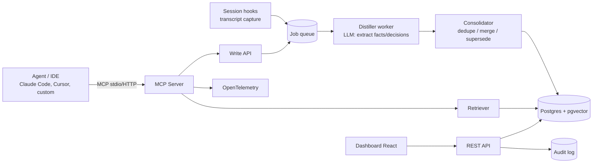

# Architecture — agent-memory-mcp

## 1. Goals / non-goals
**Goals:** local-first, framework-agnostic (MCP), fast retrieval (<150 ms p95 excluding LLM), verifiable deletion, measurable gains.
**Non-goals:** being a full agent runtime; graph-database dependency in v1.

## 2. System overview


## 3. Components
| Component | Responsibility | Notes |
|---|---|---|
| MCP server | Exposes tools `memory_write`, `memory_search`, `memory_forget`, `memory_list`, `memory_context_for` | stdio + streamable HTTP |
| Capture adapters | Read agent transcripts / hooks, send raw events | start with Claude Code hooks |
| Distiller | Turn raw events into typed memories (fact, decision, preference, todo, error-fix) | structured output (JSON schema), small local model |
| Consolidator | Similarity check → merge, update, mark superseded | keeps `valid_from/valid_to` |
| Retriever | Hybrid: vector + full-text ranking (tsvector, pg_trgm; not true BM25) + recency + importance, then optional rerank | returns score breakdown for explainability |
| Dashboard | Browse/edit/delete, search playground, "why retrieved" | doubles as demo |
| Audit log | Records writes/deletes (ids, actor, time), never content | GDPR evidence |

## 4. Data model (draft)
```sql
memories(id uuid, scope_user text, scope_project text, scope_agent text, scope_session text null,
         type text, content text, embedding vector(1024), embed_model text,
         importance real, created_at timestamptz, valid_from timestamptz, valid_to timestamptz null,
         superseded_by uuid null, source_event_ids uuid[])
events(id uuid, scope_user text, scope_project text, session_id text, ts timestamptz,
       kind text, payload jsonb, ttl_at timestamptz)
audit_log(id bigserial, action text, actor text, target_ids uuid[], ts timestamptz)
```

## 5. Key flows
**Write path:** event → redact secrets/PII → store → queue (job carries ids only, never content) → distill (batch per session end) → consolidate → upsert.
**Read path:** `memory_context_for(task)` → embed query → hybrid top-k (k=20) → rerank → token-budgeted pack (default 1,500 tokens) → return with citations to memory ids.
**Forget path:** resolve targets (user/topic/time/id) → follow links to source events, sibling memories and older versions → tombstone events → delete events, then memories → audit entry → return receipt → nightly scrub removes the bytes from disk.

## 6. Design decisions (ADR log)
| # | Decision | Alternatives | Why |
|---|---|---|---|
| 1 | Postgres + pgvector | Qdrant, Chroma | one DB for vectors, text search, audit; easy ops |
| 2 | Async distillation | inline on write | keeps agent latency low |
| 3 | Typed memories | free text chunks | better consolidation & dashboard UX |
| 4 | MCP as primary interface | SDK-only | works across agent vendors |
| 5 | `pg-boss` queue on the same Postgres, jobs carry ids only | Redis/BullMQ | no new service; `forget` cannot miss content held in a queue |
| 6 | `pg` with hand-written SQL migrations | ORM | hybrid queries, RLS and vector indexes are raw-SQL work anyway |
| 7 | Tool names use underscores | dotted names | dots are valid MCP but some clients reportedly filter them |
| 8 | Redact at ingest, before storage | redact before distillation | otherwise secrets persist in `events` |
| 9 | Identity from client config, never tool arguments | scope as a tool argument | a prompt-injected agent cannot cross scopes |
| 11 | Tool output never reaches the distiller | distill everything | `qwen3` stored a planted instruction despite a prompt calling the transcript data. Tool output is where third-party text enters |
| 12 | One memory may supersede several | one-to-one | a changed fact can outdate a decision that depended on it, and a stale decision misleads later sessions |
| 13 | Dashboard served by the server | a separate container | one origin, no CORS, one fewer process |
| 14 | Forget deletes now, scrubs bytes nightly | `VACUUM FULL` on every forget | a scan proved plain `VACUUM` leaves deleted text in table files, but `VACUUM FULL` locks tables and rebuilds the index |
| 15 | Tombstones for forgotten events | none | a resumed session re-sends its transcript and would restore forgotten text |
| 16 | Ask if each fact, decision and preference will last | more word lists, an importance cutoff | 241 of 254 memories on a long history were chatter. Word lists fit only the filler they were written for, and ordinary real facts also score 0.5. Fixes and todos skip it because they describe events |
| 17 | Ask whether acting on each candidate would cause harm | trust the source, or a word list | planted text reaches memory when a person relays it or the agent quotes it, and reads as a lasting rule. A source check would also drop genuine team decisions passed on by the user |
| 18 | A keyword match needs only the code-like words, when the query has any, and then counts as much as a vector match | every word, or any word; one weight for all questions | requiring every word lost the code match whenever a question added words the memory lacks, and at half weight a keyword-only match ranks below every vector candidate. On a third held-out set the right code came first for 100%, against 83.5% and 63.0% for vectors alone, with plain questions unchanged in the top 10 |
| 19 | No agent or session scope | scopes set by tool arguments | `memory_write` took `agent` and `session` as arguments, which decision 9 forbids for anything that separates memories, and nothing filtered on them. The columns stay for existing rows and export; new memories leave them empty |
| 10 | `english` text config | `simple` | `simple` keeps stop words, which then count as matches. Other languages still match exact words |

## 7. Security & privacy
- Scope isolation enforced in every query (row-level security)
- Secrets/PII filter at ingest, before anything is stored (regex + optional NER), configurable redaction
- API keys per client; local mode binds to localhost only

## 8. Observability
OpenTelemetry traces for write/read/forget; metrics: retrieval latency, memories per scope, distillation cost, hit rate.

## 9. Repo layout
```
packages/core  packages/server  packages/distiller  packages/dashboard  packages/adapters
eval/  docs/  docker-compose.yml  .github/workflows/
```

## 10. Open questions
- Best default token budget per task type?
- When to forget automatically (decay vs. explicit TTL)?
- How far can memory poisoning be reduced when the planted text comes from the user or is repeated by the agent? A harm check on each memory and each of its clauses cut held-out poisoning to 3 of 30, with no genuine rule lost. What remains are instructions the model rewrites as the fix itself. See the evaluation report
- What minimum relevance should retrieval require? Rank fusion has no absolute cutoff, so a small store returns unrelated memories. Tune against the eval.
