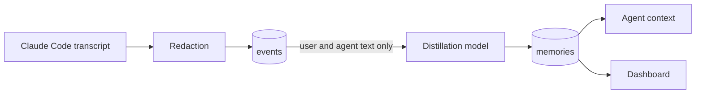

# Privacy and data flows

This describes what agent-memory-mcp stores, where it goes and how erasure works. It is engineering documentation, not legal advice.

## What is stored

| Data | Where | Holds personal data? |
|---|---|---|
| Transcript events: what the user and agent said, and tool output | `events` | Yes, after redaction |
| Memories distilled from those events | `memories` | Yes |
| Embeddings of memories | `memories.embedding` | Derived from the text, so treat them as content |
| Forgotten event ids | `forgotten_events` | One-way hashes, no content |
| Distillation status per session | `distill_status` | The user id and session id |
| Queue jobs | `pgboss.job` | The user id, project and session id, never content |
| Audit log | `audit_log` | Action, time, ids and actor name, never content |

## Where data goes

- **Local mode, the default:** the models run in Ollama, so nothing leaves your infrastructure.
- **Hosted mode:** with `DISTILL_MODEL=anthropic:<model>`, session text is sent to Anthropic for distillation. The worker logs a warning at startup. Embeddings stay local.
- **Telemetry:** off unless `OTEL_EXPORTER_OTLP_ENDPOINT` is set. Spans hold operation names, durations and error class names only, and a test enforces this.
- **Tool output** (file contents, web pages, command results) is stored after redaction but never sent to a model.

## Redaction

Secrets and direct identifiers are removed before anything is stored: API keys, tokens, private keys, passwords, credentials in connection strings, and email addresses. `memory_write` is redacted too. This is pattern matching, so it reduces risk but cannot catch everything, such as names or a secret in an unknown format.

## Rights

| Right | How |
|---|---|
| Access and portability (Art. 15, 20) | Dashboard Export, or `GET /v1/export` |
| Rectification (Art. 16) | Dashboard Edit, or `PATCH /v1/memories/:id`. The embedding is rebuilt |
| Erasure (Art. 17) | Dashboard Forget, or `POST /v1/forget` by person, topic, date range or id |
| Storage limitation (Art. 5) | `RETENTION_DAYS` removes expired rows daily |

## What erasure covers

Forget follows every link that could carry the same content, and errs towards deleting more:

- the matching memories and the events they came from
- other memories built from those events, because a merged memory can hold text from any of its sources
- older versions of a forgotten memory
- all tool output from an affected session
- text that matched the topic but never became a memory

It also handles three cases a plain delete would miss:

- **A distiller running at that moment** cannot write the content back. A write needs its source events to still exist, and holds a lock so the forget waits and then removes what it wrote.
- **A resumed session** cannot restore forgotten text. Transcripts are re-sent in full, so a forgotten event's id is kept as a one-way hash and refused on arrival.
- **Forgetting a whole person** reaches all their projects, removes their queue jobs and status rows, and replaces their name in the audit log with `erased`. The audit rows stay as evidence.

Every forget returns a receipt with counts and a fingerprint of the deleted ids.

## Limits

These are not solved by the software, and you should plan for them.

- **Timing on disk.** A forget removes content from every read path at once, and a daily scrub (`VACUUM FULL`) then removes the bytes from table files. This scrub runs at 03:00 only if something was deleted, and briefly locks the tables. A test reads the raw files to confirm it. Until then, the bytes remain in unused page space.
- **Write-ahead log.** Deleted text stays in Postgres WAL until those segments are recycled, which by default happens shortly after checkpoints.
- **Backups.** A forget cannot reach backups or volume snapshots. Set their retention to match your policy, and if you restore one, re-run outstanding erasures. `forgotten_events` protects against resumed sessions, not against a restored database.
- **The host.** Disk blocks are not securely overwritten. Use full-disk encryption.
- **Topic matching.** It finds the words of the topic, and memories close to it in meaning. Text that says the same thing differently may be missed, so preview first and forget by person where certainty matters.
- **Agents.** A forget cannot reach what an agent already read into a running session, or anything a hosted provider has processed under its own retention terms.
- **Memory poisoning.** Skipping tool output closes the main route for planted instructions, but text the user pastes, or that the agent repeats, can still become a memory. Memories are returned as stored data to verify, not as instructions.
